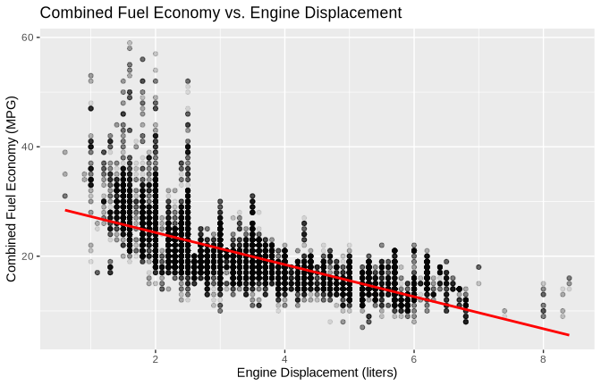
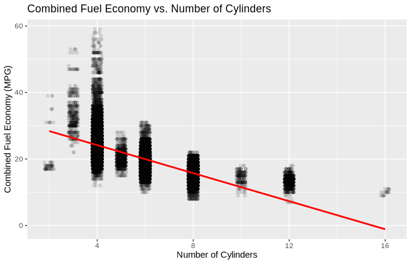
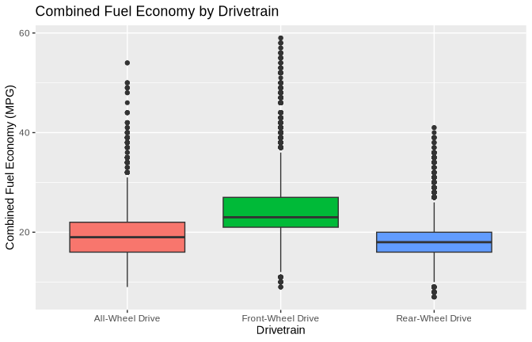

Predicting Fuel Economy with Multivariable Regression
================
Robby Dosanjh

## Overview

This analysis models combined fuel economy (MPG) for passenger vehicles
using engine size and drivetrain. Two multivariable regression models
are built and compared using hypothesis tests, *R*², and residual error.

**Data:** EPA Fuel Economy dataset, all model years 1984–2025,
downloaded from
[fueleconomy.gov](https://fueleconomy.gov/feg/download.shtml).

## Setup and data cleaning

Plug-in hybrids running in blended mode and vehicles with zero tailpipe
CO₂ (fully electric) are removed, since their fuel economy is not driven
by a combustion engine.

``` r
library(dplyr)
library(ggplot2)
library(mosaic)

vehicles <- read.csv("../data/vehicles.csv")

vehicles <- vehicles |>
  filter(phevBlended == "false",
         co2TailpipeGpm > 0)
```

## Recoding drivetrain

The original `drive` variable has several overlapping categories, which
are combined into three levels.

``` r
vehicles <- vehicles |>
  mutate(drivetrain = case_when(
    drive %in% c("2-Wheel Drive",
                 "Front-Wheel Drive")          ~ "Front-Wheel Drive",
    drive %in% c("4-Wheel Drive",
                 "4-Wheel or All-Wheel Drive",
                 "Part-time 4-Wheel Drive",
                 "All-Wheel Drive")            ~ "All-Wheel Drive",
    TRUE                                       ~ "Rear-Wheel Drive"
  ),
  drivetrain = factor(drivetrain))

tally(~ drivetrain, data = vehicles)
```

    ## drivetrain
    ##   All-Wheel Drive Front-Wheel Drive  Rear-Wheel Drive 
    ##             14695             15860             16402

``` r
# Crosstab to confirm each original category was assigned correctly
tally(drive ~ drivetrain, data = vehicles)
```

    ##                             drivetrain
    ## drive                        All-Wheel Drive Front-Wheel Drive Rear-Wheel Drive
    ##                                            0                 0             1178
    ##   2-Wheel Drive                            0               493                0
    ##   4-Wheel Drive                         2377                 0                0
    ##   4-Wheel or All-Wheel Drive            6645                 0                0
    ##   All-Wheel Drive                       5136                 0                0
    ##   Front-Wheel Drive                        0             15367                0
    ##   Part-time 4-Wheel Drive                537                 0                0
    ##   Rear-Wheel Drive                         0                 0            15224

## 1. Correlations

``` r
cor(comb08 ~ displ, data = vehicles, use = "complete.obs")
```

    ## [1] -0.7247147

``` r
cor(comb08 ~ cylinders, data = vehicles, use = "complete.obs")
```

    ## [1] -0.6825643

Combined fuel economy has a strong negative correlation with engine
displacement (*r* = −0.72) and a moderately strong negative correlation
with the number of cylinders (*r* = −0.68), meaning vehicles with larger
engines and more cylinders tend to get fewer miles per gallon.
Displacement is slightly more strongly related to fuel economy than
cylinder count.

## 2. Model 1: displacement and cylinders

``` r
vehicles |>
  ggplot(aes(x = displ, y = comb08)) +
  geom_point(alpha = 0.1) +
  geom_smooth(method = "lm", color = "red", se = FALSE) +
  labs(title = "Combined Fuel Economy vs. Engine Displacement",
       x = "Engine Displacement (liters)",
       y = "Combined Fuel Economy (MPG)")
```

<!-- -->

``` r
vehicles |>
  ggplot(aes(x = cylinders, y = comb08)) +
  geom_jitter(alpha = 0.1, width = 0.2, height = 0) +
  geom_smooth(method = "lm", color = "red", se = FALSE) +
  labs(title = "Combined Fuel Economy vs. Number of Cylinders",
       x = "Number of Cylinders",
       y = "Combined Fuel Economy (MPG)")
```

<!-- -->

``` r
comb08.lm1 <- lm(comb08 ~ displ + cylinders,
                 data = vehicles,
                 na.action = na.exclude)

summary(comb08.lm1)
```

    ## 
    ## Call:
    ## lm(formula = comb08 ~ displ + cylinders, data = vehicles, na.action = na.exclude)
    ## 
    ## Residuals:
    ##     Min      1Q  Median      3Q     Max 
    ## -11.449  -2.349  -0.449   1.627  33.634 
    ## 
    ## Coefficients:
    ##             Estimate Std. Error t value Pr(>|t|)    
    ## (Intercept) 31.00429    0.06178  501.87   <2e-16 ***
    ## displ       -2.39558    0.03017  -79.39   <2e-16 ***
    ## cylinders   -0.45143    0.02303  -19.60   <2e-16 ***
    ## ---
    ## Signif. codes:  0 '***' 0.001 '**' 0.01 '*' 0.05 '.' 0.1 ' ' 1
    ## 
    ## Residual standard error: 3.757 on 46951 degrees of freedom
    ##   (3 observations deleted due to missingness)
    ## Multiple R-squared:  0.5291, Adjusted R-squared:  0.5291 
    ## F-statistic: 2.638e+04 on 2 and 46951 DF,  p-value: < 2.2e-16

Model 1 predicts combined fuel economy as 31.00 − 2.40(displ) −
0.45(cylinders). Each extra liter of engine displacement lowers fuel
economy by about 2.4 MPG, and each extra cylinder lowers it by about
0.45 MPG. The *R*² of 0.529 shows that these two variables explain about
53% of the variation in fuel economy, and predictions are usually off by
about 3.8 MPG. Both variables and the overall *F*-test have *p*-values
far below .05, so we reject the null hypothesis and conclude that
displacement and cylinders are both significant predictors of fuel
economy.

## 3. Model 2: displacement and drivetrain

``` r
vehicles |>
  ggplot(aes(x = drivetrain, y = comb08, fill = drivetrain)) +
  geom_boxplot() +
  labs(title = "Combined Fuel Economy by Drivetrain",
       x = "Drivetrain",
       y = "Combined Fuel Economy (MPG)") +
  theme(legend.position = "none")
```

<!-- -->

``` r
favstats(comb08 ~ drivetrain, data = vehicles)
```

    ##          drivetrain min Q1 median Q3 max     mean       sd     n missing
    ## 1   All-Wheel Drive   9 16     19 22  54 19.06315 4.492583 14695       0
    ## 2 Front-Wheel Drive   9 21     23 27  59 24.38058 5.610240 15860       0
    ## 3  Rear-Wheel Drive   7 16     18 20  41 18.26253 3.988854 16402       0

``` r
comb08.lm2 <- lm(comb08 ~ displ + drivetrain,
                 data = vehicles,
                 na.action = na.exclude)

summary(comb08.lm2)
```

    ## 
    ## Call:
    ## lm(formula = comb08 ~ displ + drivetrain, data = vehicles, na.action = na.exclude)
    ## 
    ## Residuals:
    ##     Min      1Q  Median      3Q     Max 
    ## -10.598  -2.318  -0.471   1.658  32.633 
    ## 
    ## Coefficients:
    ##                             Estimate Std. Error  t value Pr(>|t|)    
    ## (Intercept)                 28.13425    0.05883  478.201  < 2e-16 ***
    ## displ                       -2.56108    0.01427 -179.534  < 2e-16 ***
    ## drivetrainFront-Wheel Drive  2.33021    0.04502   51.763  < 2e-16 ***
    ## drivetrainRear-Wheel Drive   0.14184    0.04182    3.391 0.000696 ***
    ## ---
    ## Signif. codes:  0 '***' 0.001 '**' 0.01 '*' 0.05 '.' 0.1 ' ' 1
    ## 
    ## Residual standard error: 3.653 on 46951 degrees of freedom
    ##   (2 observations deleted due to missingness)
    ## Multiple R-squared:  0.5549, Adjusted R-squared:  0.5549 
    ## F-statistic: 1.951e+04 on 3 and 46951 DF,  p-value: < 2.2e-16

Model 2 predicts combined fuel economy as 28.13 − 2.56(displ) +
2.33(Front-Wheel Drive) + 0.14(Rear-Wheel Drive), compared with
all-wheel drive. Each extra liter of displacement lowers fuel economy by
about 2.56 MPG, and with the same engine size, front-wheel drive
vehicles get about 2.33 MPG more than all-wheel drive vehicles, while
rear-wheel drive vehicles get only about 0.14 MPG more. The *R*² of
0.555 means this model explains about 55.5% of the variation in fuel
economy, with predictions usually off by about 3.65 MPG. The *F*-test
and every coefficient have *p*-values below .05, with the largest being
.0007 for rear-wheel drive, so we reject the null hypothesis and
conclude that all of the variables are significant.

## 4. Residual analysis

``` r
vehicles <- vehicles |>
  mutate(lm1_fitted = predict(comb08.lm1),
         lm1_resid  = resid(comb08.lm1),
         lm2_fitted = predict(comb08.lm2),
         lm2_resid  = resid(comb08.lm2))

# Sum of absolute deviations (SAD) and sum of squared deviations (SSD)
q2SAD <- sum(abs(vehicles$lm1_resid), na.rm = TRUE)
q2SSD <- sum(vehicles$lm1_resid^2, na.rm = TRUE)

q3SAD <- sum(abs(vehicles$lm2_resid), na.rm = TRUE)
q3SSD <- sum(vehicles$lm2_resid^2, na.rm = TRUE)
```

| Model                              | SAD        | SSD        |
|------------------------------------|------------|------------|
| Model 1: displacement + cylinders  | 124,785.37 | 662,846.81 |
| Model 2: displacement + drivetrain | 121,884.86 | 626,526.88 |

## 5. Choosing the better model

Both models are statistically significant overall, and every variable in
each one has a *p*-value well below .05, so the hypothesis tests alone
don’t show which model is better. Comparing the residuals, Model 2 had a
smaller SAD (121,884.86 vs. 124,785.37 for Model 1) and a smaller SSD
(626,526.88 vs. 662,846.81), so its predictions were closer to the
actual values overall. Model 2 also had a higher *R*² (0.555 vs. 0.529)
and a lower residual standard error (3.65 vs. 3.76 MPG). Taken together,
Model 2 is the better model.

## 6. Conclusion

Engine size was the most important variable in predicting combined fuel
economy. The best model was Model 2, which predicts fuel economy as
28.13 − 2.56(displ) + 2.33(Front-Wheel Drive) + 0.14(Rear-Wheel Drive).
All of the coefficients were significant, and rear-wheel and all-wheel
drive vehicles perform about the same once engine size is taken into
account. These results could help car buyers who want better gas
mileage, since a smaller engine and front-wheel drive make the biggest
difference, and manufacturers could use them to estimate how engine and
drivetrain choices affect fuel economy targets. Model 2 still leaves
about 45% of the variation unexplained and underestimates hybrids the
most, so adding variables like hybrid technology, vehicle class, or
model year would likely make the predictions more accurate.
