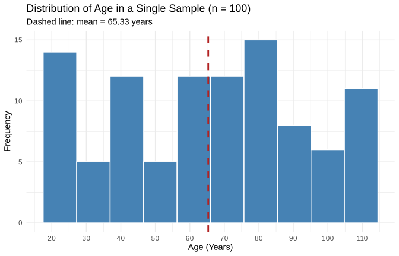
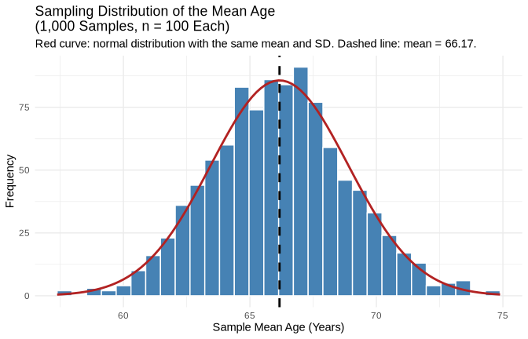
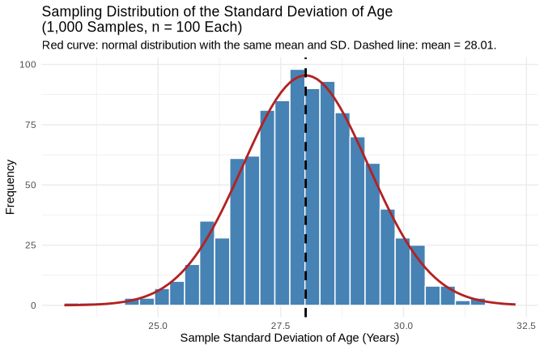

Sampling Distributions of the Mean and Standard Deviation
================
Robby Dosanjh

## Overview

This simulation compares a single sample to the sampling distributions
of the mean and standard deviation, built from 1,000 samples of 100
adult ages. Because the population is known (a discrete uniform
distribution of ages 18–114, with μ = 66 and σ = 28), it shows directly
how much more accurate the sampling distribution is than a single
sample.

## Setup and simulated data

``` r
library(knitr)    # kable() for formatted tables
library(mosaic)   # favstats() for descriptive statistics
library(dplyr)    # mutate() and select()
library(ggplot2)  # histograms and normal curve overlays

seedValue <- 605
set.seed(seedValue)

# 1,000 samples (columns) of 100 ages (rows), drawn uniformly from 18-114
dataMatrix <- matrix(
  sample(18:114, 100 * 1000, replace = TRUE),
  nrow = 100,
  ncol = 1000
)

df <- data.frame(dataMatrix)
```

This dataset consists of 1000 sample sets of 100 observations each.

### Helper functions

``` r
skewness <- function(x) {
  mean((x - mean(x))^3) / mean((x - mean(x))^2)^1.5
}

kurtosis <- function(x) {
  mean((x - mean(x))^4) / mean((x - mean(x))^2)^2 - 3
}

describeVar <- function(x) {
  favstats(x) |>
    mutate(
      IQR      = Q3 - Q1,
      Skewness = skewness(x),
      Kurtosis = kurtosis(x)
    ) |>
    select(n, Min = min, Q1, Median = median, Q3, Max = max,
           Mean = mean, SD = sd, IQR, Skewness, Kurtosis) |>
    as_tibble()
}

statNames <- c("n", "Min", "Q1", "Median", "Q3", "Max", "Mean", "SD",
               "IQR", "Skewness", "Excess Kurtosis")

fmt <- function(x, digits = 2) formatC(x, format = "f", digits = digits)

plotSamplingDist <- function(values, mainTitle, xLabel) {
  valMean  <- mean(values)
  valSD    <- sd(values)
  valN     <- length(values)
  binWidth <- diff(range(values)) / 30  # 30 equal-width bins

  normalCount <- function(x) {
    dnorm(x, mean = valMean, sd = valSD) * valN * binWidth
  }

  ggplot(data.frame(value = values), aes(x = value)) +
    geom_histogram(
      binwidth = binWidth,
      boundary = min(values),
      fill     = "steelblue",
      color    = "white"
    ) +
    geom_function(fun = normalCount, color = "firebrick", linewidth = 1) +
    geom_vline(xintercept = valMean, linetype = "dashed", linewidth = 1) +
    labs(
      title    = mainTitle,
      subtitle = paste0("Red curve: normal distribution with the same mean ",
                        "and SD. Dashed line: mean = ", fmt(valMean), "."),
      x        = xLabel,
      y        = "Frequency"
    ) +
    theme_minimal()
}
```

## 1. Single sample analysis

``` r
singleSample <- df$X1
singleStats  <- describeVar(singleSample)

kable(
  singleStats,
  digits    = 2,
  col.names = statNames,
  caption   = "Descriptive Statistics of Age for a Single Sample (X1)"
)
```

|   n | Min |    Q1 | Median |   Q3 | Max |  Mean |    SD |   IQR | Skewness | Excess Kurtosis |
|----:|----:|------:|-------:|-----:|----:|------:|------:|------:|---------:|----------------:|
| 100 |  18 | 41.75 |     67 | 84.5 | 114 | 65.33 | 27.73 | 42.75 |    -0.07 |           -1.06 |

Descriptive Statistics of Age for a Single Sample (X1)

``` r
ggplot(df, aes(x = X1)) +
  geom_histogram(
    breaks = seq(17.5, 114.5, length.out = 11),
    fill   = "steelblue",
    color  = "white"
  ) +
  geom_vline(
    xintercept = singleStats$Mean,
    color      = "firebrick",
    linetype   = "dashed",
    linewidth  = 1
  ) +
  scale_x_continuous(breaks = seq(20, 110, by = 10)) +
  labs(
    title    = "Distribution of Age in a Single Sample (n = 100)",
    subtitle = paste0("Dashed line: mean = ", fmt(singleStats$Mean), " years"),
    x        = "Age (Years)",
    y        = "Frequency"
  ) +
  theme_minimal()
```

<!-- -->

The ages in this single sample (*n* = 100) ranged from 18 to 114 years,
spanning the full possible range, and the mean (*M* = 65.33) was
slightly below the median (*Mdn* = 67.00), with a skewness of -0.07
indicating a nearly symmetric distribution. Instead of a bell-shaped
normal pattern, the histogram showed a flat distribution with no
dominant peak, and the negative excess kurtosis (-1.06) affirmed a
platykurtic, roughly uniform shape with light tails. There was also
great variability, with a standard deviation of 27.73 years and an
interquartile range of 42.75 years, meaning the middle 50% of ages fell
between 41.75 and 84.50 years.

## 2. Sampling distribution of the mean

``` r
sampleMeans <- apply(X = df, MARGIN = 2, FUN = mean)
dfMeans     <- data.frame(sampleMeans)

meanStats <- describeVar(dfMeans$sampleMeans)

kable(
  meanStats,
  digits    = 2,
  col.names = statNames,
  caption   = "Descriptive Statistics of the Sampling Distribution of the Mean"
)
```

|    n |   Min |    Q1 | Median |    Q3 |   Max |  Mean |   SD |  IQR | Skewness | Excess Kurtosis |
|-----:|------:|------:|-------:|------:|------:|------:|-----:|-----:|---------:|----------------:|
| 1000 | 57.38 | 64.35 |  66.15 | 67.89 | 74.89 | 66.17 | 2.72 | 3.54 |     0.08 |            0.03 |

Descriptive Statistics of the Sampling Distribution of the Mean

``` r
seMean   <- sd(dfMeans$sampleMeans)
seSingle <- sd(singleSample) / sqrt(length(singleSample))

cat("Standard error (SD of the sampling distribution of the mean):",
    round(seMean, 4), "\n")
```

    ## Standard error (SD of the sampling distribution of the mean): 2.717

``` r
cat("Estimated standard error from the single sample (s / sqrt(n)):",
    round(seSingle, 4), "\n")
```

    ## Estimated standard error from the single sample (s / sqrt(n)): 2.7728

``` r
plotSamplingDist(
  dfMeans$sampleMeans,
  mainTitle = "Sampling Distribution of the Mean Age\n(1,000 Samples, n = 100 Each)",
  xLabel    = "Sample Mean Age (Years)"
)
```

<!-- -->

The sampling distribution of the mean, consisting of 1,000 sample means,
was unimodal and nearly normal, with skewness (0.08) and excess kurtosis
(0.03) both close to zero and a mean (*M* = 66.17) approximately equal
to its median (*Mdn* = 66.15). The standard deviation of the sample
means, which is also the standard error (*SE* = 2.72), was about one
tenth of the single-sample standard deviation and closely approximated
the slightly larger formula-based estimate of *s*/√*n* = 2.77, with
every sample mean falling between 57.38 and 74.89 years. As the central
limit theorem predicts, averaging 100 observations per sample
transformed a population with a flat, uniform distribution into a
bell-shaped distribution of sample means tightly clustered around the
population mean.

## 3. Sampling distribution of the standard deviation

``` r
sampleSDs <- apply(X = df, MARGIN = 2, FUN = sd)
dfSDs     <- data.frame(sampleSDs)

sdStats <- describeVar(dfSDs$sampleSDs)

kable(
  sdStats,
  digits    = 2,
  col.names = statNames,
  caption   = "Descriptive Statistics of the Sampling Distribution of the SD"
)
```

|    n |   Min |    Q1 | Median |    Q3 |   Max |  Mean |   SD |  IQR | Skewness | Excess Kurtosis |
|-----:|------:|------:|-------:|------:|------:|------:|-----:|-----:|---------:|----------------:|
| 1000 | 23.09 | 27.16 |  28.01 | 28.89 | 32.28 | 28.01 | 1.28 | 1.73 |    -0.13 |            0.12 |

Descriptive Statistics of the Sampling Distribution of the SD

``` r
plotSamplingDist(
  dfSDs$sampleSDs,
  mainTitle = "Sampling Distribution of the Standard Deviation of Age\n(1,000 Samples, n = 100 Each)",
  xLabel    = "Sample Standard Deviation of Age (Years)"
)
```

<!-- -->

The sampling distribution of the standard deviation was unimodal and
approximately normal, with a mean (*M* = 28.01) and median (*Mdn* =
28.01) that were about the same. It also had a slight negative skew
(-0.13) and excess kurtosis close to zero (0.12). Sample standard
deviations ranged from 23.09 to 32.28 years with little spread (*SD* =
1.28), which means that any random sample of 100 adults shows a similar
level of variation in age. This tight clustering implies that the mean
of the sample standard deviations is a steady estimate of the population
standard deviation.

## 4. Conclusion

The sampling distribution of the mean yielded a more accurate estimate
of the true population mean than the single-sample estimate. The single
sample had a mean age of 65.33 years (*SD* = 27.73, *SE* = 2.77) with a
95% CI \[59.83, 70.83\], an interval about 11 years wide, showing that
any one sample of 100 is subject to considerable sampling error. The
sampling distribution, in contrast, averaged 1,000 different sample
means, so random overestimates and underestimates cancelled out. The
standard error of the grand mean decreased to only 0.086 years
(*SE*/√1,000). Based on the sampling distributions, the population mean
age is estimated at 66.17 years and the population standard deviation at
28.01 years. These estimates were similar to the actual parameters of
the simulated discrete uniform population of ages 18–114 (μ = 66, σ =
28), with the sampling-distribution estimate of the mean differing from
μ by only 0.17 years, compared with 0.67 years for the single sample.
