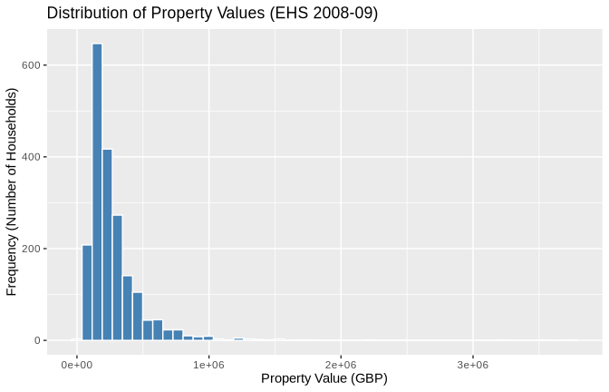
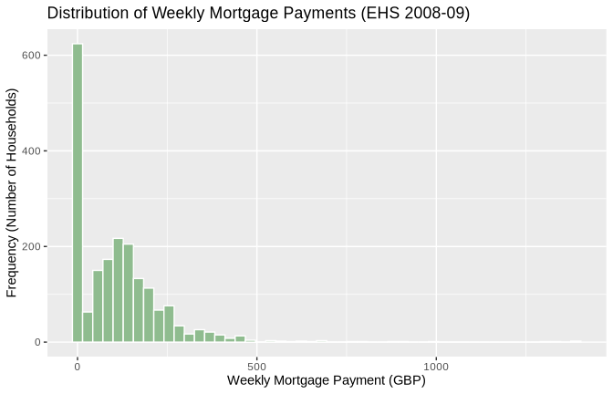
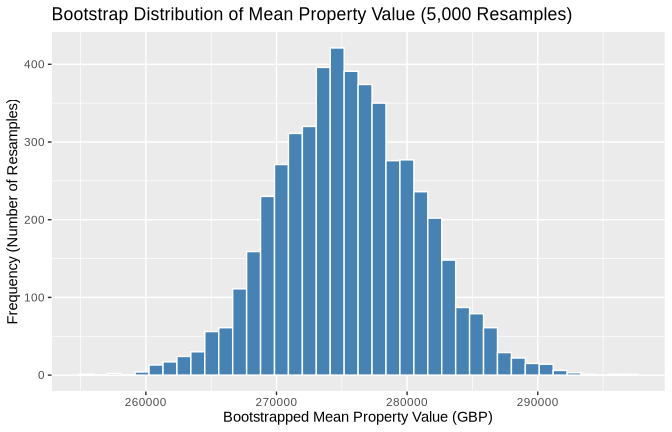
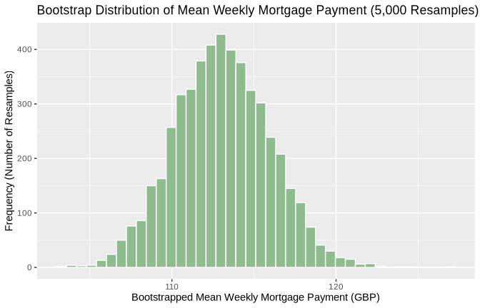

Bootstrapping Property Values and Mortgage Payments (English Housing
Survey)
================
Robby Dosanjh

## Overview

Property values and weekly mortgage payments are both heavily
right-skewed, which makes normal-theory inference questionable. This
analysis uses bootstrap resampling (5,000 resamples) to estimate the
sampling distribution of each mean and build confidence intervals
without assuming normality.

**Data:** a subset of the English Housing Survey 2008–09, with weekly
mortgage payment (`mortwkx`), joint household income (`jointincx`), and
property value (`prptval1`), all in British pounds (GBP).

## Setup

``` r
library(mosaic)

seedValue <- 8675309

ehs <- read.csv("../data/ehs-2009-subset.csv",
                na.strings = c("", "NA"))
ehs <- na.omit(ehs)
```

## 1. Descriptive statistics

``` r
df_stats(~ mortwkx + jointincx + prptval1, data = ehs)
```

    ##    response  min     Q1     median        Q3        max        mean          sd
    ## 1   mortwkx    0      0     95.565    170.29    1388.89    113.0919    129.3909
    ## 2 jointincx 3146  21560  35000.000  54070.96 1300937.50  44916.6728  50477.7955
    ## 3  prptval1  335 150000 210000.000 320000.00 3750000.00 275477.8778 236342.3594
    ##      n missing
    ## 1 1980       0
    ## 2 1980       0
    ## 3 1980       0

``` r
n <- nrow(ehs)
n
```

    ## [1] 1980

## 2. Distributions

``` r
ggplot(ehs, aes(x = prptval1)) +
  geom_histogram(bins = 50, fill = "steelblue", color = "white") +
  labs(title = "Distribution of Property Values (EHS 2008-09)",
       x = "Property Value (GBP)",
       y = "Frequency (Number of Households)")
```

<!-- -->

``` r
ggplot(ehs, aes(x = mortwkx)) +
  geom_histogram(bins = 50, fill = "darkseagreen", color = "white") +
  labs(title = "Distribution of Weekly Mortgage Payments (EHS 2008-09)",
       x = "Weekly Mortgage Payment (GBP)",
       y = "Frequency (Number of Households)")
```

<!-- -->

Both distributions are unimodal and strongly right-skewed. Property
values range from £335 to £3,750,000, with the mean (£275,478)
substantially higher than the median (£210,000) and a large standard
deviation (£236,342), reflecting a long right tail of high-value
properties (skewness 5.63). Weekly mortgage payments range from £0 to
£1,388.89, with a mean of £113.09, a median of £95.57, and a standard
deviation of £129.39. There is a large spike at £0, which corresponds to
households with no mortgage (609 households, 30.8%), and another
right-skewed tail toward higher payments (skewness 3.03).

## 3. Why bootstrapping fits this data

Bootstrapping is appropriate for this dataset because property values
and weekly mortgage payments both depart significantly from a normal
distribution, with skewness of 5.63 and 3.03, respectively, extreme high
outliers, and a large number of zero payments. With *n* = 1,980
households, the sample is large enough to stand in for the population,
allowing the sampling distribution of the mean to be approximated by
resampling with replacement without assuming a particular population
shape.

## 4. Bootstrap distribution of mean property value

``` r
set.seed(seedValue)
bootPropVal <- do(5000) * mean(~ prptval1, data = resample(ehs, size = n))

data.frame(
  Statistic = c("Bootstrap Mean of Property Value (GBP)",
                "Bootstrap Standard Error (GBP)"),
  Value = round(c(mean(~ mean, data = bootPropVal),
                  sd(~ mean, data = bootPropVal)), 2)
)
```

    ##                                Statistic     Value
    ## 1 Bootstrap Mean of Property Value (GBP) 275550.68
    ## 2         Bootstrap Standard Error (GBP)   5364.93

``` r
ggplot(bootPropVal, aes(x = mean)) +
  geom_histogram(bins = 40, fill = "steelblue", color = "white") +
  labs(title = "Bootstrap Distribution of Mean Property Value (5,000 Resamples)",
       x = "Bootstrapped Mean Property Value (GBP)",
       y = "Frequency (Number of Resamples)")
```

<!-- -->

Compared with the strongly right-skewed distribution of individual
property values, the bootstrap distribution of 5,000 sample means is
almost perfectly symmetric (skewness 0.10), centered at about £275,551,
close to the sample mean of £275,478. The spread of bootstrap means is
very narrow, ranging only from £255,446 to £297,051. The bootstrap
standard error was £5,365, far smaller than the original standard
deviation of £236,342 and very close to the theoretical value of
*SD*/√*n* (£5,311). The mean is estimated far more precisely than
individual values vary, with a 95% percentile interval from £265,223 to
£286,336.

## 5. Bootstrap distribution of mean weekly mortgage payment

``` r
set.seed(seedValue)
bootMortWk <- do(5000) * mean(~ mortwkx, data = resample(ehs, size = n))

data.frame(
  Statistic = c("Bootstrap Mean of Weekly Mortgage Payment (GBP)",
                "Bootstrap Standard Error (GBP)"),
  Value = round(c(mean(~ mean, data = bootMortWk),
                  sd(~ mean, data = bootMortWk)), 2)
)
```

    ##                                         Statistic  Value
    ## 1 Bootstrap Mean of Weekly Mortgage Payment (GBP) 113.07
    ## 2                  Bootstrap Standard Error (GBP)   2.90

``` r
ggplot(bootMortWk, aes(x = mean)) +
  geom_histogram(bins = 40, fill = "darkseagreen", color = "white") +
  labs(title = "Bootstrap Distribution of Mean Weekly Mortgage Payment (5,000 Resamples)",
       x = "Bootstrapped Mean Weekly Mortgage Payment (GBP)",
       y = "Frequency (Number of Resamples)")
```

<!-- -->

While individual weekly mortgage payments were heavily right-skewed, the
bootstrap distribution of the mean was roughly bell-shaped (skewness
0.09) and symmetric around £113.07, essentially the same as the sample
mean. The bootstrap means ranged narrowly from £103.28 to £126.93,
versus £0 to £1,388.89 in the raw data. The bootstrap standard error of
£2.90 was about 45 times smaller than the original standard deviation of
£129.39 and nearly identical to the theoretical *SD*/√*n* value of
£2.91, showing that the mean is estimated much more precisely than
individual payments vary.

## 6. Summary

Bootstrap resampling (5,000 resamples of *n* = 1,980) produced
approximately normal sampling distributions for the means of property
value (£275,551) and weekly mortgage payment (£113.07), despite the
skewness of the original data. The bootstrap means differed from the
sample means by less than 0.03%, indicating that the sample mean is a
nearly unbiased estimator of the population mean. The bootstrap standard
errors were roughly 44 times smaller than the original standard
deviations and very close to the theoretical *SD*/√*n*, so despite the
very wide spread of individual values, the mean is quite stable and
conventional inference for the mean is reliable at this sample size. The
95% percentile intervals ran from £265,223 to £286,336 for property
value and from £107.41 to £118.73 for weekly mortgage payment, giving
ranges for the population mean without assuming normality. Nonetheless,
the mean is heavily influenced by outliers and by the 30.8% of
households with no mortgage payment, so the median may be a more
representative value for both variables. The bootstrap reflects only
sampling variability, so it cannot fix data quality problems such as the
suspicious property valuation of £335.
