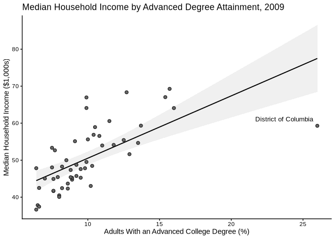
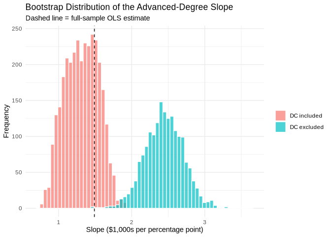

Educational Attainment and State Median Household Income: Regression and
Bootstrap Analysis
================
Robby Dosanjh

## Overview

Does educational attainment explain why median household income varies
so much across U.S. states? This analysis models 2009 median household
income for the 50 states and the District of Columbia using two
predictors: the share of adults with a high school diploma and the share
with an advanced degree. Classical regression inference is then checked
against 5,000 bootstrap resamples, since the sample is small (*N* = 51),
some variables are skewed, and one observation (DC) is an extreme
outlier.

The full written report is in [report.pdf](report.pdf).

**Data:** 2012 Statistical Abstract of the United States subset, via
SAGE Research Methods Datasets (2015). Income is in thousands of
dollars; education variables are percentages of adults.

## Setup

``` r
library(mosaic)
library(ggplot2)
library(knitr)

seedValue <- 8675309

states <- read.csv("../data/us-stats-abstract-2012-subset.csv")
```

## 1. Descriptive statistics

``` r
vars <- c(medianincome = "Median household income ($1,000s)",
          highschool   = "High school diploma or more (%)",
          college      = "Advanced college degree (%)")

desc <- do.call(rbind, lapply(names(vars), function(v) {
  x  <- states[[v]]
  ci <- t.test(x)$conf.int
  data.frame(Variable = vars[[v]], M = mean(x), Mdn = median(x), SD = sd(x),
             Min = min(x), Max = max(x), LL = ci[1], UL = ci[2])
}))

kable(desc, digits = 2, row.names = FALSE,
      caption = "Descriptive statistics with 95% t-based confidence intervals for the means")
```

| Variable                           |     M |   Mdn |   SD |   Min |   Max |    LL |    UL |
|:-----------------------------------|------:|------:|-----:|------:|------:|------:|------:|
| Median household income (\$1,000s) | 50.45 | 48.26 | 8.46 | 36.65 | 69.27 | 48.07 | 52.83 |
| High school diploma or more (%)    | 86.00 | 87.00 | 3.63 | 78.50 | 91.20 | 84.98 | 87.02 |
| Advanced college degree (%)        |  9.95 |  9.20 | 3.31 |  6.40 | 26.00 |  9.02 | 10.88 |

Descriptive statistics with 95% t-based confidence intervals for the
means

``` r
# Extremes for each education variable
states[c(which.min(states$highschool), which.max(states$highschool),
         which.min(states$college), which.max(states$college)),
       c("state", "highschool", "college")]
```

    ##                     state highschool college
    ## 25            Mississippi       78.5     6.4
    ## 51                Wyoming       91.2     7.7
    ## 25.1          Mississippi       78.5     6.4
    ## 9    District of Columbia       85.7    26.0

## 2. Multicollinearity check

``` r
r_predictors <- cor(states$highschool, states$college)
c(r = round(r_predictors, 2), VIF = round(1 / (1 - r_predictors^2), 2))
```

    ##    r  VIF 
    ## 0.22 1.05

The predictors are only weakly correlated (VIF ≈ 1.05), so
multicollinearity is not a concern.

## 3. Multivariable regression

``` r
income.lm <- lm(medianincome ~ highschool + college, data = states)
summary(income.lm)
```

    ## 
    ## Call:
    ## lm(formula = medianincome ~ highschool + college, data = states)
    ## 
    ## Residuals:
    ##     Min      1Q  Median      3Q     Max 
    ## -14.821  -3.732  -1.441   2.553  12.967 
    ## 
    ## Coefficients:
    ##             Estimate Std. Error t value Pr(>|t|)    
    ## (Intercept) -35.2163    19.4631  -1.809 0.076655 .  
    ## highschool    0.8239     0.2306   3.572 0.000817 ***
    ## college       1.4893     0.2527   5.892 3.66e-07 ***
    ## ---
    ## Signif. codes:  0 '***' 0.001 '**' 0.01 '*' 0.05 '.' 0.1 ' ' 1
    ## 
    ## Residual standard error: 5.774 on 48 degrees of freedom
    ## Multiple R-squared:  0.5528, Adjusted R-squared:  0.5342 
    ## F-statistic: 29.67 on 2 and 48 DF,  p-value: 4.086e-09

``` r
confint(income.lm)
```

    ##                   2.5 %   97.5 %
    ## (Intercept) -74.3495812 3.916894
    ## highschool    0.3601744 1.287581
    ## college       0.9810894 1.997448

``` r
# Standardized coefficients (beta)
coef(income.lm)[-1] * sapply(states[c("highschool", "college")], sd) / sd(states$medianincome)
```

    ## highschool    college 
    ##  0.3531369  0.5824741

## 4. Influence and assumptions

``` r
cooks <- cooks.distance(income.lm)
states$state[which.max(cooks)]
```

    ## [1] "District of Columbia"

``` r
round(max(cooks), 2)
```

    ## [1] 4.87

``` r
# Refit without the District of Columbia
income.lm.noDC <- lm(medianincome ~ highschool + college,
                     data = subset(states, state2 != "DC"))
round(coef(income.lm.noDC), 2)
```

    ## (Intercept)  highschool     college 
    ##      -26.78        0.62        2.44

``` r
round(summary(income.lm.noDC)$r.squared, 2)
```

    ## [1] 0.67

``` r
# Normality of residuals
shapiro.test(resid(income.lm))
```

    ## 
    ##  Shapiro-Wilk normality test
    ## 
    ## data:  resid(income.lm)
    ## W = 0.95143, p-value = 0.03616

## 5. Figure: income vs. advanced degree attainment

``` r
ggplot(states, aes(x = college, y = medianincome)) +
  geom_smooth(method = "lm", color = "black", fill = "grey85", linewidth = 0.7) +
  geom_point(shape = 21, fill = "grey40", size = 2) +
  annotate("text", x = states$college[states$state2 == "DC"] - 0.3,
           y = states$medianincome[states$state2 == "DC"] + 1.8,
           label = "District of Columbia", hjust = 1, size = 3.5) +
  labs(title = "Median Household Income by Advanced Degree Attainment, 2009",
       x = "Adults With an Advanced College Degree (%)",
       y = "Median Household Income ($1,000s)") +
  theme_classic()
```

<!-- -->

``` r
round(cor(states$college, states$medianincome), 2)
```

    ## [1] 0.66

## 6. Bootstrap

Each of the 5,000 resamples recomputes the three means and the full
regression model.

``` r
bootFun <- function(r) {
  c(income     = mean(r$medianincome),
    highschool = mean(r$highschool),
    college    = mean(r$college),
    coef(lm(medianincome ~ highschool + college, data = r))[2:3],
    noDC       = !("DC" %in% r$state2))
}

set.seed(seedValue)
boot <- do(5000) * bootFun(resample(states))
names(boot) <- c("mean_income", "mean_highschool", "mean_college",
                 "slope_highschool", "slope_college", "noDC")

stat_cols <- names(boot)[1:5]
kable(data.frame(
  Statistic      = stat_cols,
  Bootstrap_Mean = colMeans(boot[stat_cols]),
  Bootstrap_SE   = sapply(boot[stat_cols], sd),
  LL             = sapply(boot[stat_cols], quantile, 0.025),
  UL             = sapply(boot[stat_cols], quantile, 0.975)
), digits = 2, row.names = FALSE,
caption = "Bootstrap means, standard errors, and 95% percentile intervals")
```

| Statistic        | Bootstrap_Mean | Bootstrap_SE |    LL |    UL |
|:-----------------|---------------:|-------------:|------:|------:|
| mean_income      |          50.45 |         1.18 | 48.17 | 52.76 |
| mean_highschool  |          86.00 |         0.50 | 85.02 | 87.00 |
| mean_college     |           9.95 |         0.45 |  9.16 | 10.92 |
| slope_highschool |           0.78 |         0.25 |  0.30 |  1.25 |
| slope_college    |           1.72 |         0.59 |  0.93 |  2.82 |

Bootstrap means, standard errors, and 95% percentile intervals

``` r
# Share of resamples with a slope <= 0, and the effect of DC on the advanced-degree slope
c(hs_slope_le_0  = mean(boot$slope_highschool <= 0),
  adv_slope_le_0 = mean(boot$slope_college <= 0),
  share_noDC     = mean(boot$noDC))
```

    ##  hs_slope_le_0 adv_slope_le_0     share_noDC 
    ##         0.0006         0.0000         0.3538

``` r
round(tapply(boot$slope_college, boot$noDC, mean), 2)
```

    ##    0    1 
    ## 1.32 2.44

``` r
ggplot(boot, aes(x = slope_college, fill = factor(noDC, labels = c("DC included", "DC excluded")))) +
  geom_histogram(bins = 60, color = "white", position = "identity", alpha = 0.7) +
  geom_vline(xintercept = coef(income.lm)["college"], linetype = "dashed") +
  labs(title = "Bootstrap Distribution of the Advanced-Degree Slope",
       subtitle = "Dashed line = full-sample OLS estimate",
       x = "Slope ($1,000s per percentage point)", y = "Frequency", fill = NULL) +
  theme_minimal()
```

<!-- -->

## Key findings

- High school completion and advanced degree attainment together
  explained 55.3% of the variation in state median household income
  (*F*(2, 48) = 29.67, *p* \< .001).
- Holding the other predictor constant, each one-point increase in high
  school completion was associated with \$824 higher median income, and
  each one-point increase in advanced degree attainment with \$1,489.
  Advanced degree attainment was the stronger predictor (β = .58
  vs. .35).
- The District of Columbia was highly influential (Cook’s *D* = 4.87).
  Removing it raised the advanced-degree slope from 1.49 to 2.44 and
  *R*² from .55 to .67.
- The bootstrap confirmed both predictors (no resample produced an
  advanced-degree slope at or below zero), but the advanced-degree slope
  was bimodal depending on whether DC was drawn. Its bootstrap SE (0.59)
  was more than twice the classical SE (0.25), so the classical interval
  overstates the precision of that estimate.
- The results are correlational and at the state level; migration of
  educated workers to high-wage states, cost of living, and industry mix
  are plausible confounders.
